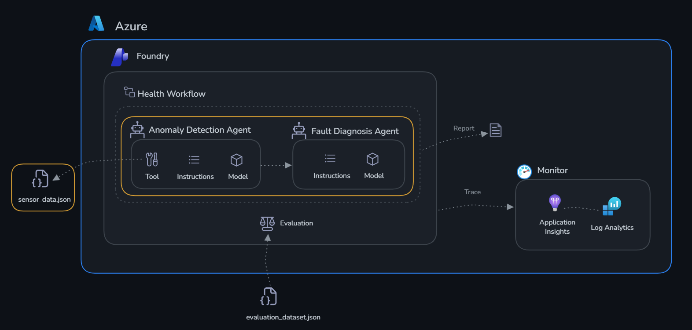
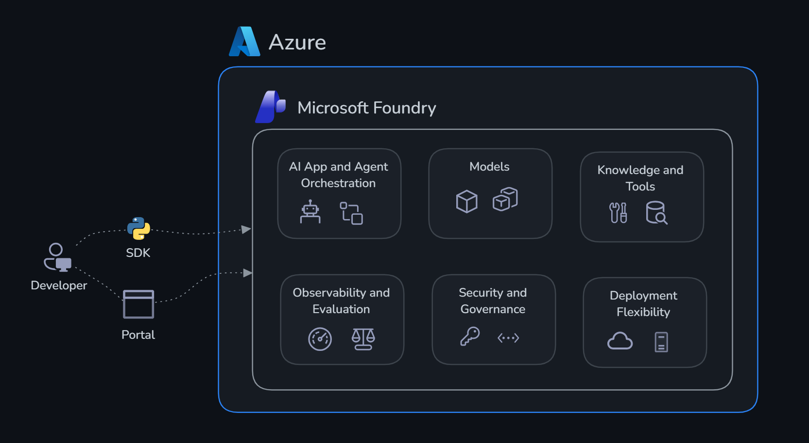

# Challenge 1: Build Agents

Time: ~30 minutes

## Objectives

By the end of this challenge, you will have:

- ✅ An **Anomaly Detection Agent** that monitors sensor data and flags abnormal readings
- ✅ A **Fault Diagnosis Agent** that analyzes flagged anomalies and recommends maintenance actions
- ✅ Both agents tested against real sensor data from the factory floor



## Context

TireForge Industries has 5 machines on the production floor. Each machine emits sensor data including temperature, pressure, vibration, and RPM. Your agents need to:

1. **Anomaly Detection**: Compare current readings against known thresholds and flag machines that are out of spec
2. **Fault Diagnosis**: Given an anomaly, reason about what might be wrong and recommend an action

Check out [sensor_data.json](./sensor_data.json) to see the current state of all machines.

## Portal or SDK?

Microsoft Foundry gives you two ways to build agents. The **Foundry portal** ([ai.azure.com](https://ai.azure.com)) provides a visual, no-code interface where you can create agents, attach tools, and test them interactively in a playground — great for exploration and rapid prototyping. The **Microsoft Foundry SDK** (the `azure-ai-projects` Python package) gives you full programmatic control: you define agent behavior, tools, and orchestration logic in Python, which makes it easy to version, test, and integrate into automated pipelines.



In this challenge we use the **SDK**. The code in [agents.py](./agents.py) creates both agents, registers their tools, and runs them against every machine in `sensor_data.json` — all from the terminal. After the script runs, both agents will also be visible in the portal under **Agents**, so you can inspect them, tweak their instructions, and test them interactively without touching any code.

## Agents and Tools

### What is an agent?

An agent in Microsoft Foundry is a versioned, server-side AI assistant backed by a large language model. Unlike a plain API call — where you send a prompt and get a single response — an agent keeps a **conversation**, can **invoke tools autonomously**, and **retains context** across multiple turns. You call it through the **Responses API**. You configure it with:

- A **name** and **model** (e.g. `gpt-5.4`)
- A **system prompt** — instructions that define its role, personality, and constraints
- One or more **tools** it can call when it needs information or actions beyond its training data

Agents are managed resources in your Foundry project. Each change creates a new **agent version**. Agents persist between runs, appear in the portal under **Agents**, and can be versioned, shared, and reused.

### What are tools?

Tools extend an agent's capabilities beyond pure language generation. When the model decides it needs information it doesn't have in its context window, it emits a **tool call** — a structured JSON request specifying the tool name and arguments. For a **function** tool, your code runs the corresponding Python function and feeds the result back to the model. Other tools, such as Code Interpreter or MCP, run on the service side. This reasoning loop continues until the agent produces a final response.

From the model's perspective, tools are described by a **JSON schema** (name, description, parameters). The model reads these descriptions and decides autonomously when and how to call them — you never hard-code the decision logic.

### What tools can you add?

| Tool type | What it does | Best for |
|-----------|-------------|----------|
| **Function** | Calls a local Python function you define | Any custom logic: database lookups, APIs, calculations |
| **Code Interpreter** | Lets the agent write and execute Python in a sandbox | Data analysis, chart generation, file processing |
| **File Search** | Searches files you upload to a vector store | A small set of documents for one agent |
| **Foundry IQ** | Agentic retrieval over a knowledge base in Azure AI Search, with citations | Manuals, policies and records shared by many agents |
| **Web Search** | Live web search with citations. No Bing resource needed | Real-time information, news |
| **MCP** | Calls tools on a remote Model Context Protocol server, with optional approval | Tools that another team or vendor hosts |
| **OpenAPI** | Calls a REST API from its OpenAPI specification | Your existing internal APIs |

#### Knowledge bases with Foundry IQ

When your agent needs to answer questions grounded in a large body of documents — policy manuals, product specs, historical records — you need **retrieval**. Unlike keyword search, vector search converts text into numerical embeddings and finds semantically similar passages at query time. This lets the agent ask a natural-language question and retrieve the right content even when the exact words don't appear in the query.

**Foundry IQ** gives your agents a managed **knowledge base** on top of Azure AI Search. A knowledge base combines one or more **knowledge sources**, such as blob storage, SharePoint or an existing index. When the agent calls it, the knowledge base plans the query, searches its sources, reranks the results and returns passages with source references. Your agent's answers are then grounded in your actual documents rather than model training data alone.

For TireForge Industries, useful knowledge sources would include:

- **Machine maintenance manuals** — repair procedures, lubrication schedules, torque specs, and replacement part numbers for each machine
- **Historical incident reports** — past failures, their root causes, and the corrective actions that resolved them
- **Supplier specification sheets** — acceptable operating tolerances, warranty conditions, and recommended sensor thresholds per machine model

With this in place, the **Fault Diagnosis Agent** could query "what are the known failure modes of the CP-003 curing press when vibration exceeds 3.0 mm/s?" and retrieve relevant maintenance history — grounding its recommendation in documented precedent rather than general LLM knowledge. You build this in [Challenge 1b](../challenge-1b-knowledge/README.md).

In this challenge the agents use **function tools**. The **Anomaly Detection Agent** uses `check_thresholds` to look up the acceptable operating ranges for each machine and compare them against live sensor readings. Without this tool, the agent would have to reason from memory alone — with it, every threshold check is grounded in actual machine spec data.

## Get Started

Open [agents.py](./agents.py) and review the implementation of both agents.

```bash
cd factory/challenge-1-build
python agents.py
```

As the script runs, watch the terminal closely — you'll see each agent being created, then each machine from `sensor_data.json` being sent through the **Anomaly Detection Agent** first, and its output handed off to the **Fault Diagnosis Agent**. You'll see the raw agent responses printed for every machine, giving you a live view of how the two agents collaborate. Once it completes, head to the [Microsoft Foundry portal](https://ai.azure.com), open your project, and navigate to **Agents** in the left sidebar — hit **Refresh** if the agents don't appear immediately, as it can take a few seconds for newly created agents to show up in the portal.

## No `az login`? Build the agents in the portal

`agents.py` needs `az login`, because an API key can't create agents. Build the same two agents in the [Foundry portal](https://ai.azure.com) instead. They don't call a tool, so you paste the sensor data into the chat.

1. Select **Build → Agents → Create agent**, enter the name `anomaly-detection-agent`, and select **Create**.
2. Select the **gpt-5.4** model, paste these instructions, then select **Save**:

    ```text
    You are an industrial sensor anomaly detection expert for TireForge Industries.
    The user pastes sensor data for the plant's machines. Compare every reading with that machine's thresholds.
    For each machine, report its name, ID, status (normal, warning or critical) and every out-of-spec reading
    with its value, the threshold it breaks and the deviation. Be concise and structured.
    ```

3. Open [sensor_data.json](./sensor_data.json), copy all of it, paste it into the chat and send it.
4. Create a second agent the same way, named `fault-diagnosis-agent`, with these instructions:

    ```text
    You are a mechanical fault diagnosis expert for TireForge Industries.
    The user pastes an anomaly report. For each machine with anomalies:
    1. Identify the most likely root cause:
       - High temperature + high pressure: likely blockage or restricted flow
       - High vibration alone: likely bearing wear, misalignment or imbalance
       - High temperature + high vibration: likely bearing failure or lubrication issue
       - Several sensors critical: compound failure, escalate immediately
    2. Recommend specific maintenance actions.
    3. Set urgency: IMMEDIATE (stop now), WITHIN 24H or MONITOR.
    Format each machine as: LIKELY CAUSE, MAINTENANCE ACTIONS, URGENCY.
    ```

5. Copy the anomaly agent's reply, paste it into the `fault-diagnosis-agent` chat and send it.

These two agents work for Challenges 1b, 2 and 3.

## Success Criteria

- [ ] Anomaly Detection Agent correctly identifies the 2 warning + 1 critical machine
- [ ] Fault Diagnosis Agent provides reasonable maintenance recommendations
- [ ] Both agents respond coherently when given a machine's sensor readings
