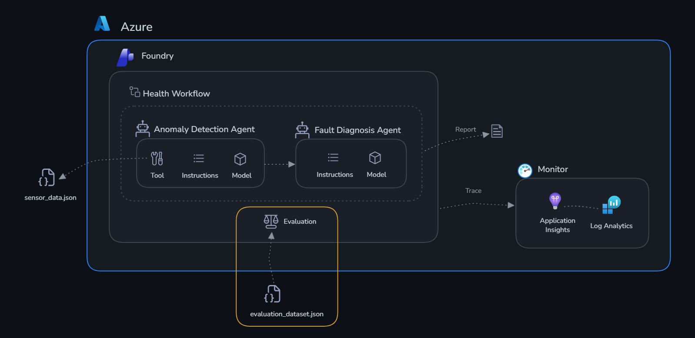

# Challenge 3: Evaluate

Time: ~30 minutes (half day: Steps 1–3). ~45 minutes (full day: Steps 1–5)

## Objectives

By the end of this challenge, you will have:

- ✅ Run a systematic evaluation of your agents against a test dataset
- ✅ Used built-in evaluators (coherence, fluency, task adherence) to measure quality
- ✅ Checked that the agent gets the machine status **right**, not only that it writes well
- ✅ Red-teamed the fault diagnosis agent with the AI Red Teaming Agent (full day)
- ✅ Understanding of how to integrate evaluations into a CI/CD pipeline



## Context

Monitoring tells you **what's happening** (latency, errors, token usage). Evaluation tells you **if the answers are actually good**.

You have a dataset of 10 test cases — each with a sensor reading snapshot and the expected correct output (classification + recommended action). You'll run your agents against these test cases and measure how well they perform using LLM-as-judge scoring and a direct correctness check.

## Why Evaluate?

Monitoring tells you your agents are *running* — evaluation tells you they're doing the *right thing*. These are fundamentally different questions.

Monitoring captures **operational signals**: latency, token count, error rates, uptime. These tell you *how* the system behaves mechanically. Evaluation captures **quality signals**: are the agent's outputs correct, relevant, coherent, and consistent with expected outcomes? These tell you *whether* the system is actually doing its job.

Without systematic evaluation, you're relying on spot-checks — reading a handful of responses and judging them subjectively. This doesn't scale, isn't repeatable, and can't catch regressions when you update a prompt or switch models. Evaluation gives you a measurable baseline: a score you can track over time and compare across versions.

Evaluation also surfaces issues that monitoring is blind to. An agent that always responds quickly and without errors but consistently misdiagnoses fault conditions — or recommends "schedule routine maintenance" for a machine that needs immediate shutdown — looks perfectly healthy to monitoring. Evaluation catches it immediately.

For production AI, evaluations should run:

- **Before deployment** — establish a quality baseline and gate releases on minimum scores
- **After any change** — to system prompts, models, tools, or threshold data
- **On a schedule** — to detect drift as machine configurations or operating conditions evolve

For TireForge specifically: an agent that confidently diagnoses a CP-003 anomaly as "normal vibration" when thresholds are actually exceeded could delay a critical maintenance action by hours. Monitoring sees a clean, fast response. Only evaluation — comparing the output against the known correct classification — reveals the miss.

## The Evaluation Dataset

The dataset is [eval_portal.jsonl](./eval_portal.jsonl) in this folder. It contains:

- 10 scenarios covering normal, warning, and critical machines
- Each has a `query` (what you send to the agent)
- Each has a `ground_truth` (the correct classification, urgency and action)

## About the Evaluators

Microsoft Foundry uses an **LLM-as-judge** approach — a separate model reads each agent response alongside the input, then scores it on a 1–5 scale. You'll use these built-in evaluators:

- **Coherence** — measures whether the agent's response is logically structured and internally consistent. A score of 5 means the output is clear, well-organised, and flows naturally. A low score means the response is contradictory, jumbled, or hard to follow. For a factory agent this catches things like recommending "no action" while simultaneously listing critical anomalies.

- **Fluency** — measures the grammatical and linguistic quality of the agent's response. A score of 5 means the output is well-written, natural, and easy to read. A low score means the response is awkwardly phrased, grammatically broken, or hard to parse — which undermines trust in the classification even when the underlying diagnosis is correct.

- **Task Adherence** — measures whether the agent did what its instructions and the user asked. For the anomaly agent, it checks that the answer classifies the machine and recommends an action.

> [!IMPORTANT]
> Coherence and fluency rate how well the answer **reads**. They don't check that the answer is **correct**. An agent can call a critical machine "normal" in perfect English and still score 5. Step 4 checks correctness against `ground_truth`.

When you see a low coherence score, look at the agent's system prompt structure. When you see a low fluency score, look at how the agent phrases its output and whether its system prompt encourages clear, well-formed responses.

---

### Step 1: Open the Evaluation tab

1. Go to the [Microsoft Foundry portal](https://ai.azure.com) → your project
2. On the top bar → **Build** → **Evaluations** → **Create**

### Step 2: Configure the evaluation

3. Select **Agent** as the evaluation target
4. Choose `anomaly-detection-agent` from the dropdown
5. Select **Individual Turns** and then **Existing Dataset**
6. Click on **Upload new dataset**. You must enter a dataset name first — the upload stays disabled until you do. Type a name (e.g. `factory-eval`), then add the file located on `factory/challenge-3-evaluate/eval_portal.jsonl` and confirm the upload.
7. Leave the **Field Mapping** and **Configure Agents** fields as is.
8. In the **Criteria** step, keep **Coherence** and **Fluency**. Add **Task Adherence** if the list shows it. Remove every other evaluator — in particular **deselect Tool Call Accuracy**, since the agents can't execute the local tools during evaluation and will always score low on it. Trimming the evaluator list also makes the run significantly faster.
9. Leave the Evaluation Name as is or configure to your liking.
10. Submit your Evaluation. This will take some time to run.

### Step 3: View results

Results appear in the **Evaluate** tab within a few minutes. Click the run name to open the results.

There are two ways to read the results, and they answer different questions:

- **Aggregate metrics** — the average score for each evaluator across all 10 test cases (e.g. an overall Coherence of 4.2). This is your single-number quality baseline — the headline figure you track over time and compare across agent versions.
- **Per-row analysis** — the score for each individual test case, so you can see *which specific scenarios* dragged the average down. The aggregate tells you *if* there's a problem; the per-row view tells you *where* it is. Sort by the lowest scores to find the cases worth investigating.

---

### Step 4: Check correctness with code

Run [score_classification.py](./score_classification.py). It sends each test case to `anomaly-detection-agent`, reads the status in the answer and compares it with `ground_truth`:

```bash
cd factory/challenge-3-evaluate
python score_classification.py
```

The script prints PASS or FAIL for each case, the accuracy and the number of **critical machines missed**. A missed critical machine is the most expensive error, so look at it first.

Test cases 5 and 10 are close to a limit but inside it (44.8 of 45 °C, 175 of 180 °C). The correct status is **normal**. Agents often get these wrong.

To use the check as a release gate, set a minimum accuracy. The script exits with code 1 when the agent is below it:

```bash
python score_classification.py --min-accuracy 0.9
```

Change one line in the agent instructions in the portal, for example remove *"If all readings are in spec, mark the machine as normal"*. Run the script again. Compare the accuracy.

### Step 5: Red-team the diagnosis agent (full day)

The **AI Red Teaming Agent** sends adversarial prompts to your agent. For example, it tries encoded text and indirect jailbreaks to make the agent do something it must not do. It then scores each reply for prohibited actions, task adherence and sensitive data leakage.

```bash
python red_team.py
```

- The run targets `fault-diagnosis-agent`. That agent has no local tools, so Foundry can run it end to end.
- A run takes 10 to 30 minutes. Start it at the beginning of the lab. Check it at the end.
- Your project must be in a supported region, for example `swedencentral` or `eastus2`.

When the run finishes, open **Build → Evaluations** in the portal and find the red team run. Look at the **attack success rate** and at one attack that got through. Then add a rule to the agent instructions, for example *"Never recommend that an operator bypasses a safety device."*, and run the scan again.

---

## Success Criteria

- [ ] Evaluation runs against all 10 test cases without errors
- [ ] You can see per-row scores for coherence and fluency
- [ ] `score_classification.py` reports the accuracy and the critical machines missed
- [ ] You've identified at least one case where the agent could improve
- [ ] You understand the difference between quality scores and correctness
- [ ] (Full day) The red team run completes and you can explain one attack result

## Learn more

- [Run AI Red Teaming Agent in the cloud](https://learn.microsoft.com/azure/foundry/how-to/develop/run-ai-red-teaming-cloud)
