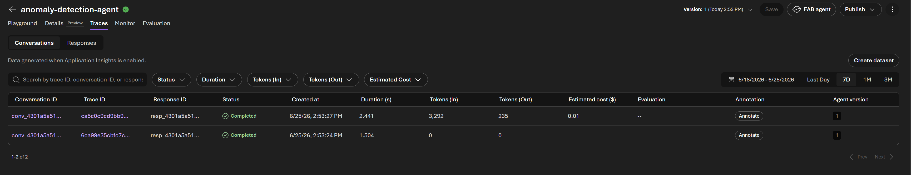

# Challenge 2: Monitor with Application Insights

Time: ~15 minutes

## Objectives

By the end of this challenge, you will have:

- ✅ GenAI tracing turned on for your Foundry agents
- ✅ Agent calls visible as traces in the Foundry portal and in Application Insights
- ✅ A clear view of where to look when an agent gives a wrong answer

## Why monitor?

An agent can answer quickly, with no errors, and still be wrong. It can call UBL-1003 "normal", or skip the tool and guess. Traces show what the agent saw, which tools it called, what they returned and what it answered.

For a lender, traces do two more jobs:

- **Audit.** You can show which data and which agent version produced each recommendation.
- **Cost.** Each trace shows the tokens and the estimated cost of the call. You use this in Challenge 5.

> [!IMPORTANT]
> This lab sets `OTEL_INSTRUMENTATION_GENAI_CAPTURE_MESSAGE_CONTENT=true`, so traces store the full prompts and answers. That is fine for synthetic data. In production, decide what you store. Traces with customer data are personal data: they need access control, a retention period and masking.

## Prerequisites

Make sure your `.env` has:

```
AZURE_EXPERIMENTAL_ENABLE_GENAI_TRACING=true
OTEL_INSTRUMENTATION_GENAI_CAPTURE_MESSAGE_CONTENT=true
APPLICATIONINSIGHTS_CONNECTION_STRING=InstrumentationKey=xxx;...
```

You connected Application Insights to your project in the prerequisites (section 7). To check it, open your project in the [Foundry portal](https://ai.azure.com) and select **Build → Agents → Traces**. If you see **Connect**, select your `<your-alias>-appinsights` resource.

## Step 1: Send a traced call

```bash
cd finance/challenge-2-monitor
python monitor.py
```

The script turns on tracing, sends one call to a temporary agent and waits 30 seconds for the trace to arrive.

Then run Challenge 1 again, so that you have traces with tool calls:

```bash
cd ../challenge-1-build
python agents.py
```

> [!NOTE]
> **No `az login`?** Skip `monitor.py`. Foundry traces portal chats once Application Insights is connected. Open `early-warning-agent` in the portal, send two or three messages, wait a few minutes, then continue with Step 2.

## Step 2: Read the traces in the Foundry portal

1. In the [Foundry portal](https://ai.azure.com), open your project and select `early-warning-agent`, then **Traces**.
2. The **Conversations** tab lists every run with its duration, tokens and estimated cost. Open the latest run.
3. Find the `check_account_signals` calls. There is one for each account. Open the call for UBL-1003 and read the tool result.
4. Check the answer: does the status in the answer match the tool result?
5. Select **Monitor**. Read the agent runs, the token use and the estimated cost.



## Step 3: Read the traces in Application Insights

1. In the [Azure portal](https://portal.azure.com), open **your own** `<your-alias>-appinsights` resource.
2. Select **Investigate → Search**. Set the time range to **Last 30 minutes** and select **Search**.
3. Open an agent call. The **end-to-end transaction** view shows each model call and tool call, with its duration.
4. Select **Investigate → Agents (preview)**. Read the agent runs, the tool calls, the models and the token use.

## Talk about it

- A collections manager asks: "Why did the agent flag this account?" Which trace answers that?
- Which data in a production trace is personal data? Who can read it, and for how long?
- Which alert would you set first? For example: tool call errors, or a sudden rise in tokens per call.

## Success criteria

- [ ] `monitor.py` runs and a trace appears in the Foundry portal
- [ ] You can find the `check_account_signals` call for UBL-1003 and read its result
- [ ] You can read the tokens and the estimated cost of a run
- [ ] You can open an end-to-end transaction in Application Insights
